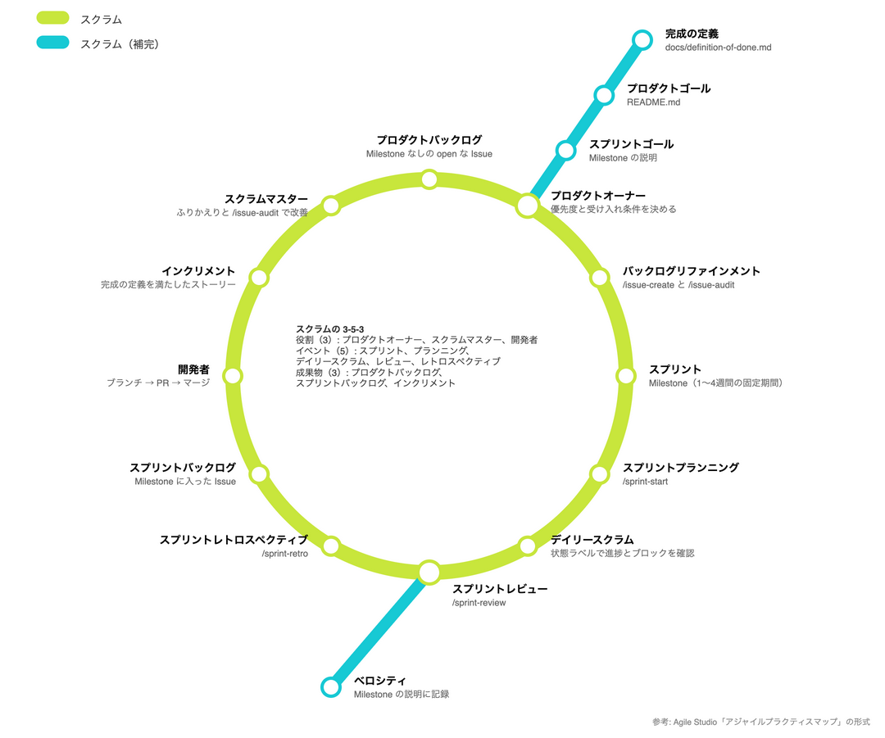
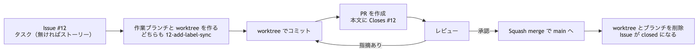

# 開発フロー

## スプリントの流れ

スクラムの役割、イベント、成果物を、地下鉄の路線図の形式で示した。形式は Agile Studio の「アジャイルプラクティスマップ」を参考にしている。



黄緑の環状線がスクラム本体の12駅で、時計回りに1スプリントを一周する。水色の支線は、スクラムを補うプラクティスだ。駅名の下の小さな文字は、このリポジトリでの対応（スキル、ファイル、Milestone）を指す。プランニング、レビュー、レトロスペクティブは、`.claude/skills/` のスキルで進められる。

## ブランチ戦略

GitHub Flow を使う。`main` は常にデプロイできる状態に保ち、`main` への変更は PR 経由だけで入れる。

- 作業ブランチは `main` から切る
- 1 ブランチ = 1 Issue。対象はタスクで、タスクを持たないストーリーはストーリーそのもの
- ブランチ名は `<Issue番号>-<kebab-case>`（例: `12-add-label-sync`）。スラッシュは使わない

## worktree

作業ブランチごとに git worktree を作る。worktree のディレクトリ名はブランチ名と同じにする。リポジトリの隣に作る。

```bash
git worktree add ../12-add-label-sync -b 12-add-label-sync origin/main
```

マージ後に worktree とブランチを消す。Squash merge は `main` に別のコミットを作るため、git から見るとブランチは未マージのままになる。ブランチの削除に `-D` が要る。

```bash
git worktree remove ../12-add-label-sync
git branch -D 12-add-label-sync
```

## PR とマージ



1. Issue から作業ブランチと worktree を作り、worktree でコミットする
2. PR を作る。本文の「関連 Issue」に `Closes #<Issue番号>` を書く
3. レビューの指摘に対応し、承認を得る
4. Squash merge で `main` に入れる。1 PR が `main` の 1 コミットになる
5. worktree とブランチを削除する

PR の本文は `.github/pull_request_template.md`、ストーリーを閉じる基準は [完成の定義](definition-of-done.md) に従う。
